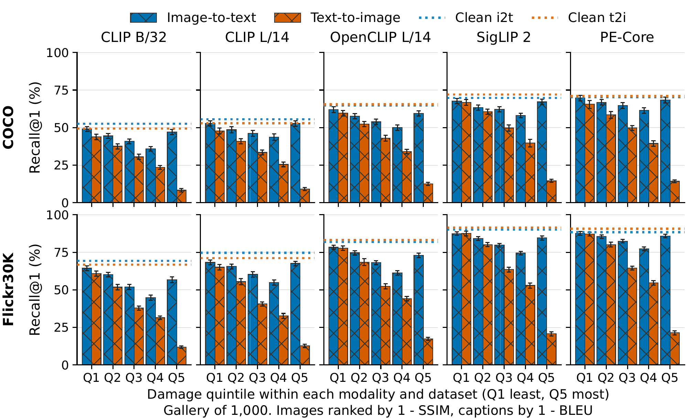

# Text-side fragility in contrastive vision-language retrieval

**Yanyu Lei**, Harvard University<br>
NeurIPS 2026, Evaluations and Datasets

[Paper](https://neurips.cc/virtual/2026/poster/139343) | [Supplementary results](#supplementary-results) | [Citation](#citation)

## Abstract

Contrastive vision-language models (VLMs) are commonly used in retrieval systems, which makes their robustness to damaged inputs an important consideration. Our study looks at how input damage affects image and text representations and retrieval performance in five VLMs. Together, the models span three Vision Transformer architectures, four training corpora, and two types of contrastive loss. Previous work evaluating cross-modal robustness generally used ordinal severity scales, but the same severity step can represent very different levels of damage for images and text. We introduce within-modality damage binning, where image and text corruptions are ranked separately on their respective damage scales before comparing retrieval performance at matched quintiles. The primary evaluation uses galleries of 1,000 pairs per dataset from MS-COCO and Flickr30K. Our results indicate that, in the highest damage quintile, image-to-text Recall@1 is 4.6 to 5.8 times as high as text-to-image Recall@1 on MS-COCO. On Flickr30K, image-to-text Recall@1 is 4.0 to 5.3 times as high as text-to-image. This retrieval gap was replicated with a larger 2,000-pair gallery for each dataset. At the highest corruption settings, deleting or replacing words moved the projected caption embeddings farther from their clean counterparts, on average, than noise, blur, or rectangular cutout moved the image embeddings. These findings suggest that retrieving images from damaged text is noticeably more fragile than the reverse, and we recommend further investigation into the text side of cross-modal robustness by utilizing precise comparisons of information loss.



**Figure 1.** Recall@1 across damage quintiles is shown for COCO (top) and Flickr30K (bottom) at a gallery of 1,000, with observations pooled across three seeds.

## Supplementary results

The NeurIPS supplementary archive, `text-side-fragility-results-v1.0.0.zip`, contains the per-query measurements, input-damage scores, figure PDFs, and tables. Its `RESULTS_README.md` explains the files and how to look up the original image–caption pair for a query. The archive is distributed as supplementary material with the paper.

## Rebuild the figures and tables

The saved measurements let you rebuild all figures and tables on a CPU. This took about 10 minutes on a laptop with 16 GB of memory. You need Git, [uv](https://docs.astral.sh/uv/getting-started/installation/), and the supplementary archive.

1. Clone the code and install the locked environment. The repository pins Python 3.12.11.

   ```bash
   git clone https://github.com/Yanyu-lei/cross-modal-asymmetry-paper.git
   cd cross-modal-asymmetry-paper
   uv sync --frozen
   ```

2. Extract the supplementary ZIP in a separate directory. Copy its `results/` folder into the root of the checkout, alongside `src/`. You should now have `results/model_outputs/` and `results/measured_damage/`.

3. Run the full build from the repository root.

   ```bash
   uv run python -m scripts.make_figures_tables_numbers --require-all
   ```

Figures go to `results/paper/figures/`, tables to `results/paper/tables/`, and additional numerical analyses to `results/paper/numbers/`. To rebuild one figure, add its step name to the command above.

| Paper output | Build step |
| --- | --- |
| Figure 1. Retrieval accuracy by damage quintile | `recall_at_1_by_damage_quintile` |
| Figure 2. Standard and mean text pooling on MS-COCO | `retention_by_text_pooling` |
| Figure 3. Retrieval accuracy by corruption at severity 5 | `recall_at_1_by_corruption_sev5` |
| Figure 4. Damage quintiles with images ranked by PSNR | `recall_at_1_psnr_binned_crosscheck` |
| Figure 5. Representation changes across encoder layers | `fidelity_by_layer_depth` |
| Figure 6. Retrieval accuracy under typos | `robustness_checks` |
| Figure 7. Object and rectangle cutout on MS-COCO | `object_cutout` |
| Tables 1–3. Models, corruption definitions, and retrieval accuracy against the clean baseline | `tables` |
| Appendix tables derived from numerical outputs | The full build runs the numerical steps before `appendix_tables`. |

List all available steps with `uv run python -m scripts.make_figures_tables_numbers --list`. To check consistency across the rebuilt outputs, run `uv run python -m pytest -q tests/test_paper_outputs.py -k built`.

## Rerun the model experiments

To generate the measurements from the original images and captions, use a fresh checkout with access to the source datasets and model weights. The runner skips completed jobs, so start with an empty results directory. On Linux, the locked CUDA 13 environment uses an NVIDIA GPU with driver 580 or newer. The experiments took 9 hours 38 minutes on four NVIDIA A40 GPUs with 48 GB of memory each. [CUDA driver compatibility](https://docs.nvidia.com/deploy/cuda-compatibility/minor-version-compatibility.html)

```bash
uv sync --frozen
uv run bash scripts/reproduce_all.sh
```

The script runs the tests, rebuilds the image manifests from the released pair lists, runs the experiments, builds the figures and tables, and checks the outputs. To inspect the experiment groups before running them, use `uv run python -m scripts.run_experiments --list`. The configurations list the runs, checkpoints, and evaluation seeds. [Pair lists](data/) · [Runs](configs/paper_runs.yaml) · [Checkpoints](configs/model_settings.yaml) · [Experiment settings](configs/experiment_settings.yaml)

## Citation

```bibtex
@inproceedings{lei2026textside,
  author    = {Lei, Yanyu},
  title     = {Text-side fragility in contrastive vision-language retrieval},
  booktitle = {Advances in Neural Information Processing Systems},
  year      = {2026},
  url       = {https://neurips.cc/virtual/2026/poster/139343}
}
```

## Licenses and attribution

The code uses the [MIT License](LICENSE). The paper's figures, tables, result files, and project documentation use [CC BY 4.0](https://creativecommons.org/licenses/by/4.0/).

The pair lists contain image identifiers and captions from MS-COCO and Flickr30K. The captions and original images retain their source terms. Flickr30K provides the images for non-commercial research and education. [COCO terms](https://cocodataset.org/#termsofuse) · [Flickr30K access terms](https://shannon.cs.illinois.edu/DenotationGraph/)

Please credit the source datasets and captions when using the pair lists. [MS-COCO (Lin et al.)](https://arxiv.org/abs/1405.0312) · [COCO Captions (Chen et al.)](https://arxiv.org/abs/1504.00325) · [Flickr30K (Young et al.)](https://aclanthology.org/Q14-1006/)

Pretrained model weights retain their respective licenses. The five checkpoints come from [OpenAI CLIP](https://github.com/openai/CLIP), [OpenCLIP](https://github.com/mlfoundations/open_clip), [SigLIP 2](https://huggingface.co/google/siglip2-so400m-patch16-384), and [Perception Encoder](https://github.com/facebookresearch/perception_models).
